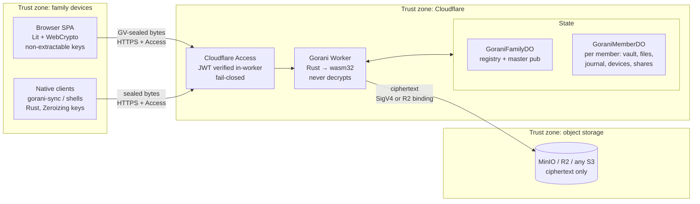
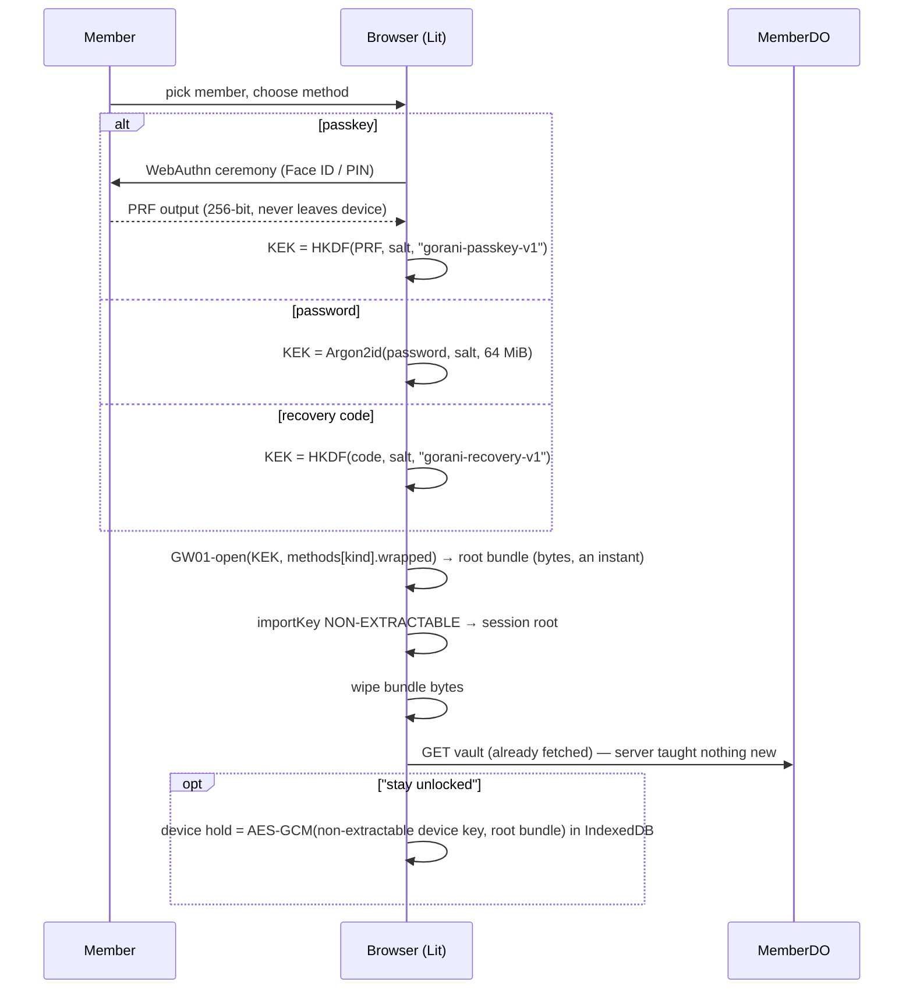
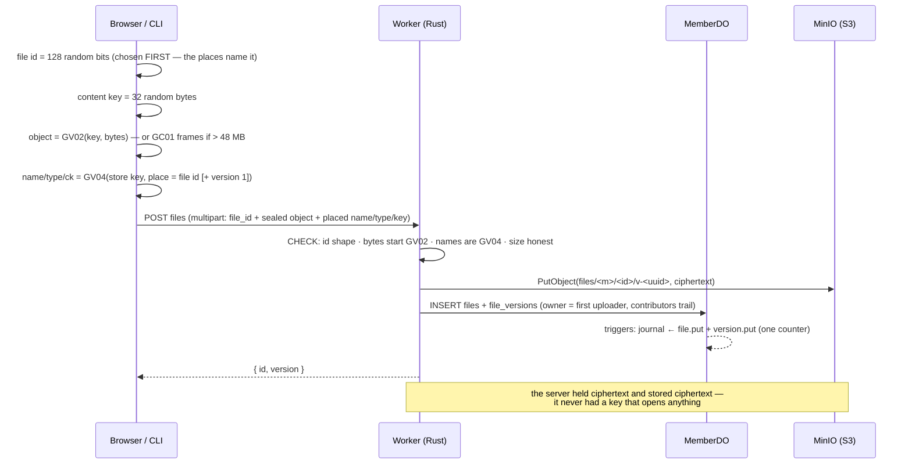
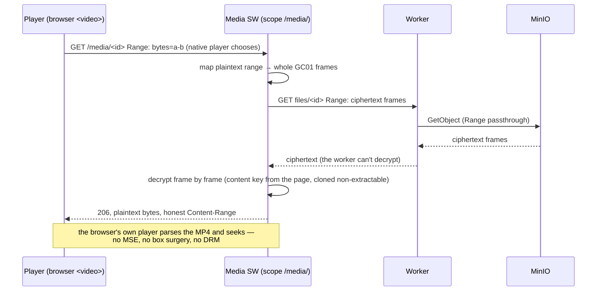
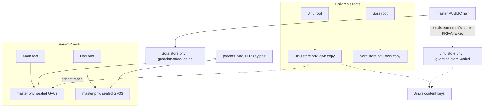
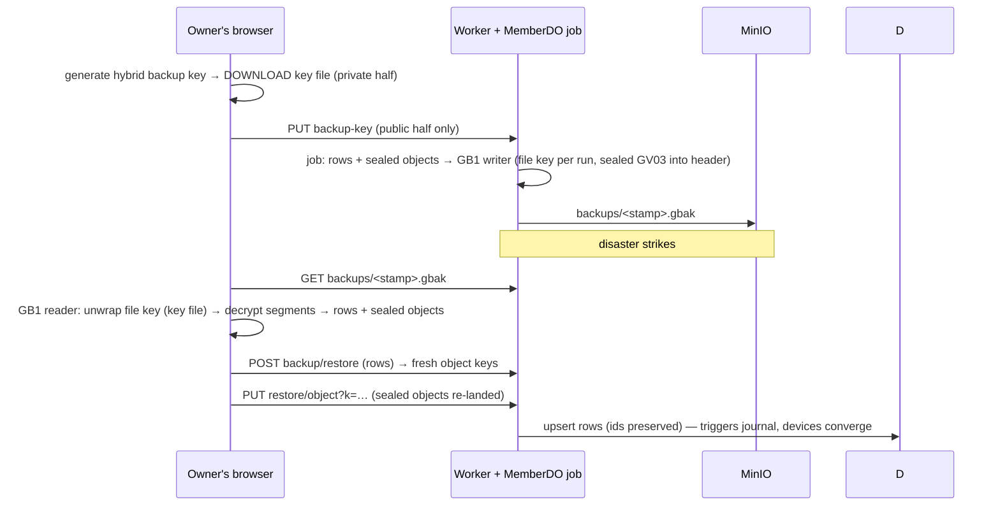
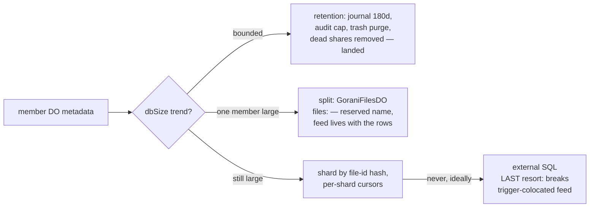

# Architecture deep-dive (with diagrams)

> Copyright 2026- Seongwoo Hong. All rights reserved.
> Companion to ARCHITECTURE.md — the flows, drawn. Diagrams are Mermaid (they render on GitHub).

## 1. The whole system, one picture

**Storage priority** (section 3's step W→S): if the deployment binds an R2
bucket, every object operation is an in-process call into R2 — no signing,
no HTTP hop, no egress — and the SigV4 adapter serves any other
S3-compatible endpoint when no binding exists. One contract, two
transports, chosen at boot (`worker/src/s3.rs › r2_bucket`). Reads add an edge
cache (`worker/src/cache.rs`): whole-object entries for small blobs (the
platform slices Ranges itself) and deterministic frame-span entries for
GC01 media — keyed by storage span, immutable by construction, ciphertext
only. The same trust rule as everywhere else: the edge never learns a
plaintext byte.

**Read the zones, not the boxes**: a device and the object storage never
talk directly; the Worker sees only ciphertext; the DOs hold structure
plus sealed text. The one thing that turns plaintext into ciphertext is
always in the leftmost zone.

## 2. Unlock: three ways to the same root

Every unlock method derives a KEK from a secret the server never sees; the
server stores only GW01-wrapped copies. Locking drops the session and (if
held) the device key.

## 3. Upload and the sealed-in boundary

The refusal path matters as much: unsealed bytes or plain names are
rejected with 400 **before** anything is stored — the zero-trust boundary
is enforced, not promised.

## 4. Download and streaming playback

## 5. The family hierarchy (why the denials hold)

- A child's root opens **only** their own store + the family area.
- The master is sealed to parents' roots, never to children's — a child's
  compromise stays contained.
- Rotating the master re-seals a handful of store keys; content never
  re-encrypts. `tests/unit/family.test.mjs` walks all of it.

## 6. Backup / disaster (the container the server can't open)

## 7. Growth (the 10 GB answer)

`GET …/vault-stats` reports `database_size()` — the split decision is made
on measurement.